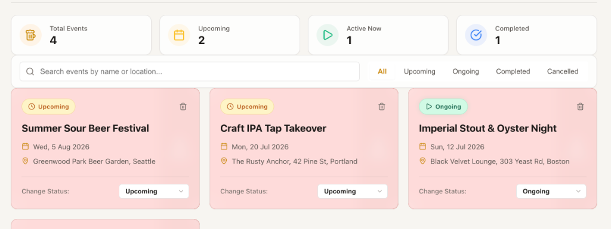
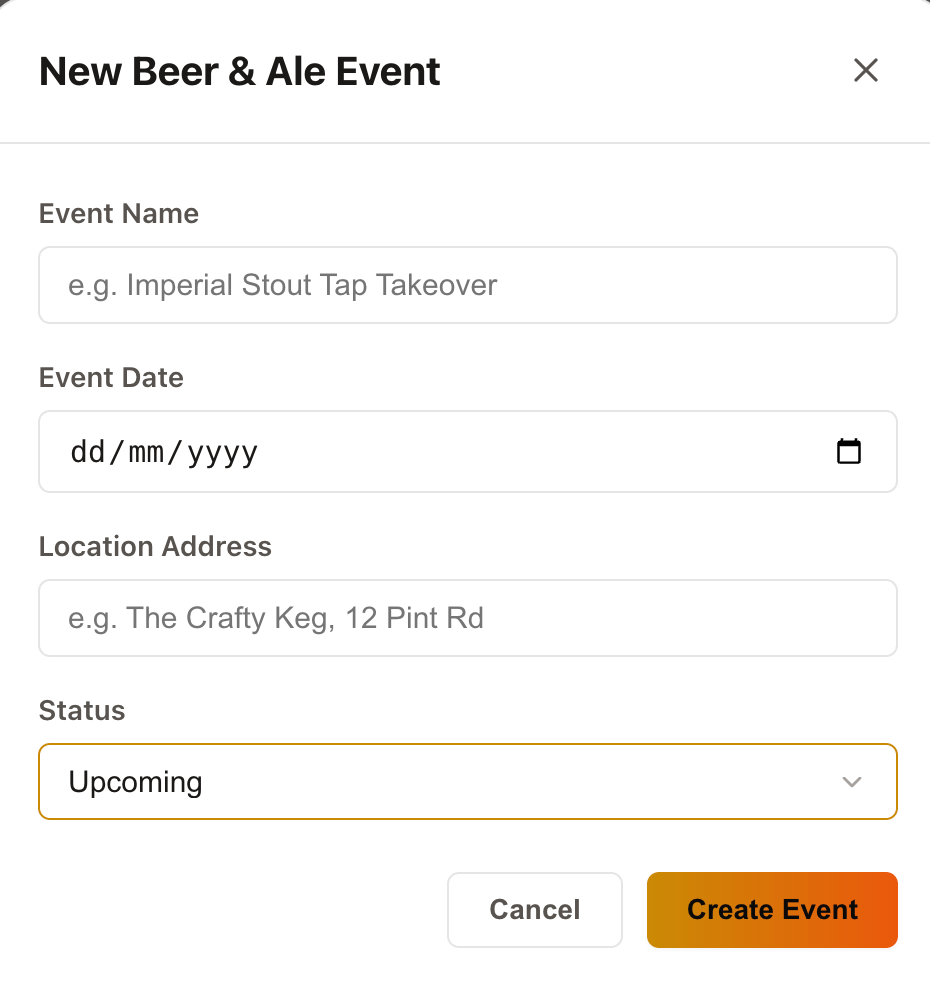

# Keg Swap 🍺


<p align="center">
  
</p>

**Keg Swap** is a premium, high-fidelity web application designed to track, discover, and swap details about local beer & ale events. Whether it's an Imperial Stout & Oyster Night, a Homebrew Exchange, or a Craft IPA Tap Takeover, Keg Swap keeps beer enthusiasts connected with a fluid, modern board interface.

---

## 🎨 Design & Theme

Keg Swap features a rich, responsive, and tactile interface styled with **Vanilla CSS Variables**.

- **Default Dark Theme:** A deep charcoal-stout dark theme (`#0c0a09` background, `#f59e0b` golden amber accent) optimized for rich low-light environments.
- **Light Theme Option:** A warm, premium theme inspired by light craft beers, ales, and barley cream tones (`#f7f5f0` background, `#ca8a04` amber gold accent).
- **Theme Persistence:** Theme preferences are stored in `localStorage` under `keg_swap_theme` and initialized immediately on page load via inline blocking script to prevent Flash of Unstyled Content (FOUC).
- **Responsive Layout:** Tailored with fluid card grids, desktop header action toolbars, and a mobile-first sticky Floating Action Button (FAB).
- **Micro-Animations:** Fluid floating card states, drag-and-swipe gestures, and scale transitions.

---

## 🛠️ Technology Stack

- **Core & Build:** [React 19](https://react.dev/), [Vite 8](https://vite.dev/), [TypeScript 6](https://www.typescriptlang.org/)
- **Backend & Cloud:** [Firebase v12](https://firebase.google.com/) (Firebase Authentication, Cloud Firestore subcollections, Cloud Storage)
- **PWA & Offline:** [vite-plugin-pwa](https://vite-pwa-org.netlify.app/) (Workbox service worker precaching, offline Firestore persistent cache)
- **Icons:** [Lucide React](https://lucide.dev/)
- **Styling:** Custom Vanilla CSS with CSS Custom Properties, layout tokens, theme loaders, and modern pseudo-selectors
- **Linter:** [Oxlint](https://github.com/oxc-project/oxc) for lightning-fast linting checks

---

## 📂 Project Structure

```bash
keg-swap/
├── index.html                  # Entry HTML template (includes FOUC-prevention theme script)
├── package.json                # Scripts, dependency mappings, and engine metadata
├── tsconfig.json               # Global TypeScript configuration compiler options
├── vite.config.ts              # Vite build pipeline, PWA plugins, and vendor chunking
├── beers.json                  # Seed catalog dataset
├── 2026_beers.json             # Festival batch sample dataset
├── src/
│   ├── main.tsx                # Application entry mount point (strict-mode rendering)
│   ├── App.tsx                 # Main controller (auth, event list, routing flags, modal state)
│   ├── App.css                 # Layout-specific stylesheet (components, dialogs, bottom sheets)
│   ├── index.css               # Global design tokens (fonts, color palettes, dark theme overrides)
│   ├── types.ts                # Core TypeScript model interfaces (BeerEvent, BeerDrink, BeerReview)
│   ├── firebase.ts             # Firebase client SDK initialization & offline cache setup
│   ├── components/
│   │   ├── AdminScreen.tsx        # Location management and admin CRUD interface
│   │   ├── AuthScreen.tsx         # User authentication (email/password sign-in & registration)
│   │   ├── BatchUploadModal.tsx   # Interactive batch beers.json dialog with record count & preview
│   │   ├── ConfirmDialog.tsx      # Reusable confirmation dialog for destructive actions
│   │   ├── CookieConsent.tsx      # Privacy & cookie consent management banner
│   │   ├── EventCard.tsx          # Event card with touch swipe-to-delete gesture & status changer
│   │   ├── EventDetailScreen.tsx  # Event view (beer list, filters, batch upload, and forms)
│   │   ├── EventModal.tsx         # Native HTML5 dialog modal for creating events
│   │   ├── PrivacyPolicyModal.tsx # GDPR privacy policy & settings dialog
│   │   ├── ShareButton.tsx        # Web Share API button with clipboard fallback
│   │   ├── StarRating.tsx         # 10-point beer glass rating widget (0.5 step increments)
│   │   ├── StatsHeader.tsx        # Header metrics dashboard (total, upcoming, active, completed)
│   │   ├── UserProfileScreen.tsx  # User profile, review history, and diary CSV export
│   │   ├── UserSearchModal.tsx    # Friend discovery modal for public profiles
│   │   └── review/                # Mobile-first review subcomponents
│   │       ├── ReviewBottomSheet.tsx   # Draggable review sheet dialog
│   │       ├── ReviewPhotoControl.tsx  # Camera and photo check-in control
│   │       ├── ServingFormatSelector.tsx # Serving size and price presets
│   │       ├── TastingNotesInput.tsx   # Tasting notes with quick-select impressions
│   │       └── TastingTagPicker.tsx    # Flavor descriptor tag cloud picker
│   ├── hooks/
│   │   ├── useIsAdmin.ts       # Firestore role checker for admin actions
│   │   ├── useReviewDraft.ts   # Review draft persistence & state manager
│   │   └── useWishlist.ts      # Private user wishlist bookmarking hook
│   ├── utils/
│   │   ├── abvUtils.ts         # ABV bracket definitions and range matchers
│   │   ├── batchBeerParser.ts  # Batch JSON validation, normalization, and error reporting
│   │   ├── dateUtils.ts        # Calendar-safe local date parsing
│   │   ├── drinkFlags.ts       # Dietary flags, drink groups, and serving format parsers
│   │   ├── eventData.ts        # Firestore subcollection operations and cascade deletes
│   │   ├── exportDiary.ts      # CSV export generator with formula sanitization
│   │   ├── imageUtils.ts       # Canvas WebP compression and Firebase Storage uploads
│   │   ├── ratingUtils.ts      # Rating clamping and sentiment calculations
│   │   ├── shareUtils.ts       # Share text and URL builders
│   │   ├── showFilter.ts       # All / Tried / Wishlist filter predicate
│   │   ├── tastingTags.ts      # Flavor tag cleaning, de-duplication, and top-3 aggregation
│   │   └── wishlist.ts         # Wishlist document read/write utilities
│   └── assets/                 # Brand logos, screenshots, and media files
```

---

## 📋 Data Schemas & Structures

### 1. Drink Schema
Available drinks in events adhere to this domain structure:
```json
{
  "id": "d1-1",
  "name": "Northern Monk Faith",
  "brewery": "Northern Monk Brew Co",
  "location": "Leeds",
  "abv": "5.4%",
  "style": "Hazy Pale Ale",
  "description": "Juicy, tropical pale ale packed with Citra and Mosaic hops.",
  "type": "Cask",
  "caskOrKeg": "Keg",
  "isVegan": true,
  "isGlutenFree": false,
  "imageUrl": "https://firebasestorage.googleapis.com/.../faith.webp",
  "reviews": []
}
```

### 2. Review Schema
Tasting reviews submitted by attendees support 10-point ratings, flavor tags, photos, and serving metadata:
```json
{
  "id": "r1",
  "userId": "usr_abc123",
  "reviewer": "Sarah M.",
  "rating": 9.5,
  "comment": "Incredibly smooth and juicy. Massive citrus notes with a velvety mouthfeel.",
  "servingSize": "Pint",
  "price": "£5.40",
  "imageUrl": "https://firebasestorage.googleapis.com/.../checkin.webp",
  "tags": ["Hazy", "Citrus", "Tropical"],
  "createdAt": "2026-07-12T16:00:00.000Z"
}
```

---

## ✨ Features & Functionality

### 1. Real-Time Firebase Auth & Firestore Sync
- **Secure Email Auth:** Clean sign-in and registration pages featuring full name profile creation (First Name + Last Name).
- **Cloud Firestore Backend:** Real-time data bindings via `onSnapshot` keep all event metrics, registered beers, and review cards updated instantly across all connected screens.

### 2. Event Analytics Dashboard
The top section features a summary dashboard displaying key metrics:
- **Total Events** registered.
- **Upcoming** events planned.
- **Active Now** events currently ongoing.
- **Completed** events history.

### 3. Native `<dialog>` Modal Creation Form
- Utilizes the modern native HTML5 `<dialog>` API.
- Implements declarative light-dismiss (`closedby="any"`) to close the modal when clicking outside, with JavaScript event fallbacks for Safari.
- Custom styled backdrop blur (`rgba(12, 10, 9, 0.7)` with `blur(8px)`).
- **Strict Form Validation:** All fields (Event Name, Date, Location, and Status) are required, styled with indicator asterisks (`*`), and validated. Input borders display immediate interactive error-clearing upon field changes.

<p align="center">
  
</p>

### 4. Interactive Event Cards
- **Click to Inspect Details:** Clicking on an event card/widget transitions the interface smoothly to the Event Detail view.
- **Status Selector:** Dropdown selector to update the event's status dynamically (e.g., transition from *Upcoming* to *Ongoing*).
- **Status Badges:** Color-coded status badges with icons to represent current progress.
- **Desktop Delete:** Single-click trash icon to instantly remove cards.
- **Mobile Swipe-to-Delete:** Touch-enabled gesture swiping left to reveal the red delete drawer (designed for mobile touch precision).

### 5. Detailed Event Screen & Drinks List
- **Detailed Event Metadata:** Shows status, dates (multi-day or single-day), venue addresses, and website links.
- **Beer Wishlist / "Want to Try":** Attendees can bookmark beers to build a personal tasting trail. Features quick toolbar tabs (`All | Tried | Wishlist`) backed by private user subdocuments.
- **Dietary & Serving Format Badges:** Clear visual badges for Vegan (`🌱`), Gluten-Free (`🌾`), and formats (`Cask`, `Keg`, `Can`, `Bottle`), with dedicated filter controls.
- **ABV Range Filter:** Dropdown filtering by gap-free ABV brackets:
  - *Low / Session:* `< 4.0%`
  - *Mid-range:* `4.0% – 5.9%`
  - *Strong:* `6.0% – 8.5%`
  - *Imperial / High Gravity:* `> 8.5%`
- **Advanced Searching & Sorting:** Instant search across beer names, breweries, styles, and descriptions, alongside average rating and review count sorting.

### 6. Interactive Batch Upload & Preview Dialog (`BatchUploadModal`)
Instead of blind, unconfirmed imports, clicking **"Upload beers.json"** opens a custom `<dialog>` control to preview and verify records before saving:
- **Drag-and-Drop Dropzone:** Drop `.json` files directly onto the modal (or onto the screen's upload button) or click to browse.
- **Expandable Schema Guide:** Live schema preview detailing mandatory keys (`name`, `brewery`, `location`, `abv`, `style`, `description`) and optional flags.
- **Potential Count Banner:** Prominently displays the total valid records ready to be imported (e.g. *"24 Beers Ready to Upload"*), the destination event, and summary stats (styles, vegan counts).
- **Duplicate Detection:** Compares incoming items against existing event drinks by name and brewery, tagging duplicates clearly.
- **Diagnostic Skipping:** Gracefully catches malformed entries, reporting skipped item counts without aborting the entire upload.
- **In-Modal Search & Style Filters:** Filter the preview list to inspect specific beers before saving.
- **Record Exclusion:** Organizers can remove individual beers from the preview with a single click prior to committing.
- **Safe Confirmation Action:** Explicit `"Upload {N} Beers"` action that batches records into Firestore with an in-app success notification, plus an escape/cancel button to exit without saving.

### 7. Mobile-Friendly Beer Review Bottom Sheet (`ReviewBottomSheet`)
- **10-Point Beer Glass Rating:** Custom beer glass icon widget supporting 0.5 to 10.0 ratings with half-glass precision.
- **Flavor & Tasting Notes Tag Cloud:** Reviewers can select preset descriptors (`Hoppy`, `Citrus`, `Tropical`, `Piney`, `Malty`, `Roasty`, `Chocolate`, `Crisp`, `Sour`, `Sweet`, etc.) or input custom tags. Drink cards aggregate and display the top 3 tasting notes.
- **Serving Size & Price Tracking:** Input serving formats (`Pint`, `Half`, `Third`, `Can`, `Bottle`) and track expenditure.
- **Photo Check-Ins:** Snap or upload drink photos, automatically compressed to WebP and stored in Firebase Cloud Storage.
- **Touch Drag-to-Dismiss:** Smooth swipe gesture to close on mobile devices.

### 8. Tasting Diary Export & Native Sharing
- **CSV Tasting Export:** Export all of your personal reviews, ratings, and notes into a clean CSV file with formula-injection protection.
- **Web Share API:** One-click native sharing on event and drink cards with automatic fallback to clipboard copy.

### 9. Scalability, Offline PWA & Cloud Architecture
- **Firestore Subcollections:** Drinks and reviews are stored as subcollections (`events/{id}/drinks/{drinkId}/reviews/{reviewId}`), eliminating 1MB document limit constraints.
- **Persistent Offline Cache:** Service worker precaching via `vite-plugin-pwa` paired with Firestore offline persistence enables smooth browsing and queued writes even in low-signal taprooms.
- **Canvas Image Compression:** Automatic client-side canvas WebP compression (max 600px, 0.75 quality) reduces storage footprint by ~60%.
- **Role-Based Security Rules:** Strict `firestore.rules` and `storage.rules` governing public profiles, attendee access, and admin privileges.

### 10. CI/CD Pipeline (Azure Static Web Apps)
- Automated deployment workflow on GitHub Actions (`.github/workflows/build.yml`).
- Runs fast oxlint and production TypeScript compilation before publishing.
- Automated Pull Request review environment creation and teardown management.

---

## 🚀 Getting Started

### Prerequisites

Make sure you have Node.js installed on your local development machine.

### Installation

Clone the repository and install all node packages:

```bash
npm install
```

### Development Server

Spin up the local hot-reloading development server:

```bash
npm run dev
```

The application will default to running on `http://localhost:5173/`.

### Building for Production

Compile TypeScript and bundle code for deployment:

```bash
npm run build
```

The production-ready assets will be created in the `dist/` directory.

### Linting Checks

Run the fast linter to check for syntax and style issues:

```bash
npm run lint
```

---

## 🔥 Firebase Integration & Setup

Keg Swap supports **Firebase Authentication** for user accounts and **Cloud Firestore** for real-time data storage. Follow the steps below to connect your own Firebase project.

### Step 1: Create a Firebase Project
1. Go to the [Firebase Console](https://console.firebase.google.com/).
2. Click **Add Project** and follow the prompts to create a new project.

### Step 2: Enable Email/Password Authentication
1. In the Firebase Console left menu, navigate to **Build > Authentication**.
2. Click **Get Started**.
3. Under the **Sign-in method** tab, click **Email/Password**.
4. Enable the provider and click **Save**.

### Step 3: Create Cloud Firestore Database
1. Navigate to **Build > Firestore Database** in the left menu.
2. Click **Create Database**.
3. Choose your database location, select **Start in production mode** (or test mode), and click **Create**.

### Step 4: Deploy Firestore Security Rules
Rules live in `firestore.rules` (and `storage.rules` for Cloud Storage). Admins are identified by a document at `admins/<their Firebase Auth uid>`.

**Order matters:**
1. In the Firebase console (Firestore Database), create a collection `admins` with a document whose ID is your Auth uid (Authentication > Users). It needs no fields.
2. Deploy the app build.
3. Deploy the rules: `firebase deploy --only firestore:rules,storage`

Deploying the rules before step 1 locks you out of admin-only writes (locations).

### Step 5: Register App & Get Config Keys
1. In the Firebase Console, go to **Project Settings** (cog icon next to Project Overview).
2. Under the **General** tab, scroll down to **Your apps** and click the Web icon (`</>`) to register a web app.
3. Give it a nickname, register it, and copy the `firebaseConfig` object keys.

### Step 6: Define Environment Variables
Create a file named `.env.local` in the root directory of your project and populate it with your Firebase keys:

```ini
# Firebase Client Configuration Keys
VITE_FIREBASE_API_KEY=your_api_key_here
VITE_FIREBASE_AUTH_DOMAIN=your_project_id.firebaseapp.com
VITE_FIREBASE_PROJECT_ID=your_project_id
VITE_FIREBASE_STORAGE_BUCKET=your_project_id.appspot.com
VITE_FIREBASE_MESSAGING_SENDER_ID=your_sender_id_here
VITE_FIREBASE_APP_ID=1:your_app_id_here
```

Vite will load these environment variables automatically in development and production build environments.
